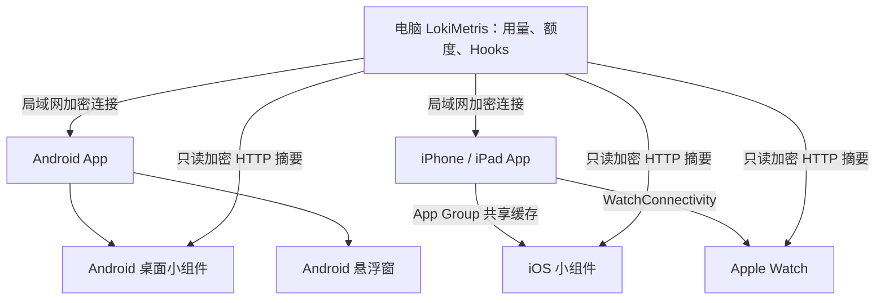

# LokiMetrisDisplay · 诡秘神谕

诡秘神谕桌面客户端：[https://github.com/ManonLoki/LokiMetis](https://github.com/ManonLoki/LokiMetis)

把电脑上的 AI 编程工具用量、账户额度和运行状态，放到手机、平板、手表和小组件上，方便随时看一眼。

数据由 [桌面端 LokiMetris](https://github.com/ManonLoki/LokiMetis) 采集，本项目负责显示。两端通过局域网连接，首次配对后自动重连。中文系统里的应用名是“诡秘神谕”，其他语言显示为“LokiMetris”。

- 想直接使用：看 [安装与连接](#安装与连接)。
- 想改代码：看 [从源码启动调试](#从源码启动调试)。
- 想了解工程：看 [文件结构](#文件结构) 和 [项目架构](#项目架构)。
- 准备发版：按 [发布检查清单](docs/06-发布检查清单.md) 核对文档。

## 能做什么

- **看 Token 用量**：Token 是模型处理内容的计量单位。可以查看总量和各工具的用量，选择大字精简模式或分项详细模式，同时保留完整整数和统计日期。
- **看账户额度**：显示桌面提供的 Codex、Claude、Cursor、Grok 等账户剩余额度，包括实际存在的每月、每周、五小时（5h）周期；套餐在账户或工具名称后以小标签显示。
- **跟随 Agent 开关**：Agent 指编程工具代理。配合支持开关同步的桌面版本，用量明细与账户额度只显示桌面设置中已开启的 Agent，总量仍沿用电脑提供的统计。
- **看 Agent 活动（Hooks）**：了解哪个工具正在运行、等你确认、出错或空闲，查看对应文字与图片。手机和平板支持每页一张或四张卡片，点开可看详情，也支持动图。
- **自动连接电脑**：打开 App 自动寻找已配对电脑；首次选择电脑、完成四位码配对，之后自动认证连接。
- **按屏幕调整布局**：适配手机、平板、横竖屏和大字号；展示台的用量与 Hooks 可以独立开关。

各端还有自己的使用方式：

| 入口 | 可以怎么用 |
| --- | --- |
| Android App | 手机、平板上看完整面板；可开启后台实时同步，并在通知栏保留运行通知 |
| Android 桌面小组件 | 调整尺寸，查看最近一次同步的用量、额度和活动摘要，点击刷新 |
| Android 悬浮窗 | 拖动、折叠小窗，在其他应用上方切换 Hooks、Token、额度三页 |
| iPhone / iPad App | 看完整面板；断线、进入后台或重启后继续显示最近一次缓存 |
| iOS 小组件 | 桌面小号／中号，以及锁屏单行／圆形／矩形摘要 |
| Apple Watch | 左右切换 Hooks、Token、额度；自动沿用已配对的 iPhone，支持离线缓存和常亮显示（Always On） |

后台更新的节奏由系统决定：Apple 的 App 后台任务、小组件和 Watch 申请间隔为 **5 分钟**；Android 普通后台任务申请间隔为 **15 分钟**。这些都是申请时间，省电策略可能让实际更新更晚。Android 开启“后台实时同步”后，会尽量保持已配对电脑的连接。

离线时，iPhone、iPad、Watch 和小组件可以保留上次结果；**Android 主面板只显示当前连接的数据**，断线后清空，桌面小组件单独保留摘要。Watch 优先从手机获取数据，手机不可达时可直接向电脑读取摘要；新图片和正文仍需通过手机同步。电脑需在线且局域网可达，才能取得新数据。

## 支持哪些设备

| 设备 | 最低系统 | 说明 |
| --- | --- | --- |
| Android 手机、平板 | Android 12（API 31） | 当前原生库包含 `arm64-v8a`、`x86_64`，可用于相应真机和模拟器 |
| iPhone | iOS 18.2 | 原生 SwiftUI 应用 |
| iPad | iPadOS 18.2 | 支持平板布局和多窗口共用连接 |
| Apple Watch | watchOS 11.0 | iPhone 配套应用，首次配置需要已配对的 iPhone；Always On 由表款和系统设置决定 |

本仓库目前提供上述移动端及其小组件。电脑端在独立的 [LokiMetis 仓库](https://github.com/ManonLoki/LokiMetis)，Wear OS、电视和网页端尚无对应构建目标。

## 安装与连接

当前发布版本为 **1.0.4**：Android 构建号 **6**，iPhone／iPad、Watch 与 Widget 构建号 **12**。改动和验证结果见 [v1.0.4 发布说明](https://github.com/ManonLoki/LokiMetisMobileDisplay/releases/tag/v1.0.4)。

### 直接安装

**Android**：到 [Releases](https://github.com/ManonLoki/LokiMetisMobileDisplay/releases) 下载该版本的 APK，允许安装后打开。发布包附带 `SHA256SUMS` 可供校验。升级时使用同签名 APK 覆盖安装，可以保留本机数据。

**iPhone / iPad / Apple Watch**：当前采用 Xcode 开发签名安装，按下文的源码调试步骤运行。Apple 包随开发者签名与设备配置安装；iPhone 宿主同时包含 Widget 与 Watch 应用。实体 Watch 是否安装成功，要在手表上单独确认。

### 第一次连接电脑

1. 在电脑上启动桌面端 LokiMetris，让电脑和移动设备处于同一局域网，并允许系统提示的本地网络访问权限。
2. 打开移动 App，进入“设置”，在发现的电脑列表中选择要连接的电脑。
3. 手机显示四位码后，在电脑弹出的配对窗口输入该码。
4. 等待显示“已连接”，回到“展示台”查看数据。以后打开 App 会自动连接保存的配对。

Android 小组件可从设置快捷添加，也可长按桌面，从“诡秘神谕／LokiMetris”的小组件列表添加。iOS 安装后先打开一次 App、完成同步，再在桌面或锁屏添加小组件。

Watch 使用系统已配对的 iPhone，打开手表应用即可自动同步，无需再和电脑配对。想让抬腕后的界面停留更久，可在手表“设置 → 通用 → 返回表盘”中为本应用调整返回时间。

Watch 后台刷新以展示数据为主，缺失的新图片在手表回到前台后继续通过手机补齐。

更新应用时使用同签名安装包覆盖安装，可保留本机配对。Android 卸载重装后需要重新配对，具体见 [签名说明](signing/README.md)。

## 从源码启动调试

以下命令在仓库根目录执行，以 macOS 为例。Apple 端当前只配置了 arm64 真机与模拟器构建，完整开发流程使用 **Apple Silicon Mac**。

### 1. 准备工具和源码

| 工具 | 用途与要求 |
| --- | --- |
| JDK 21 | Gradle 构建；仓库的后台进程配置指定 Azul 21 |
| Android Studio、Android SDK、NDK | Android 开发；安装 SDK Platform 37、Platform Tools 和 NDK，NDK 需包含 API 31 的 Clang |
| Xcode | Apple 开发；需包含符合上表系统要求的 SDK 和模拟器运行时，选为当前命令行工具目录 |
| Rust / Cargo / rustup | 编译共享配对与加密核心，工具链版本满足所选桌面仓库 `Cargo.toml` 的要求 |
| Python 3 | 运行仓库自带的构建与签名脚本，脚本只使用标准库 |

Gradle 使用仓库的 `./gradlew`，依赖版本由清单和 Wrapper 管理。首次构建会下载所需的 Gradle、Kotlin 和 Cargo 依赖。

**完整 App 还依赖桌面仓库的 Rust 源码。** 把两个仓库都准备好，并选用与目标移动版本兼容的桌面提交：

```sh
git clone https://github.com/ManonLoki/LokiMetisMobileDisplay.git
git clone https://github.com/ManonLoki/LokiMetis.git
cd LokiMetisMobileDisplay
```

下面的 `/absolute/path/to/LokiMetis` 都要替换成你本机桌面仓库的绝对路径。默认路径是原开发环境的目录，新环境应显式指定。

### 2. Android：编译、安装、打断点

在 Android Studio 中打开本仓库，通过 SDK Manager 准备 SDK 与 NDK。SDK 路径放在本机 `local.properties` 的 `sdk.dir` 中；也可以设置 `ANDROID_HOME`，需要指定 NDK 时设置 `ANDROID_NDK_HOME`。这些路径无需提交到仓库。

准备 Rust 的 Android 编译目标：

```sh
rustup target add aarch64-linux-android x86_64-linux-android
```

Debug 与 Release 都使用项目固定签名。换电脑时迁移原有 `signing/lokimetris.keystore` 和 `signing/signing.properties`；本机已有原开发证书时执行：

```sh
python3 scripts/prepare_android_signing.py
```

真正首次安装、无需兼容旧签名时，用 `python3 scripts/prepare_android_signing.py --new-key` 初始化。签名材料的保存和迁移见 [signing/README.md](signing/README.md)。

将 Android SDK 的 `platform-tools` 加入 `PATH`，以便终端找到 `adb`。真机先开启“开发者选项 → USB 调试”，连接电脑后允许调试授权；模拟器从 Android Studio 的 Device Manager 启动。

编译并安装到已连接的设备或已启动的模拟器：

```sh
./gradlew :androidApp:assembleDebug \
  -PlokiDesktopRoot=/absolute/path/to/LokiMetis

adb install -r androidApp/build/outputs/apk/debug/androidApp-debug.apk
adb shell am start -n com.manonloki.lokimetrisdisplay/.MainActivity
```

需要断点调试时，选择 Android Studio 的 `androidApp` 运行配置和目标设备，点击 **Debug**。IDE 构建同样需要桌面源码路径，可在本机用户级 `~/.gradle/gradle.properties` 中设置：

```properties
lokiDesktopRoot=/absolute/path/to/LokiMetis
```

打 Release APK 时，把任务换成 `:androidApp:assembleRelease` 并保留路径参数；输出位于 `androidApp/build/outputs/apk/release/androidApp-release.apk`。

### 3. iPhone / iPad：用 Xcode 运行

准备 Rust 的 Apple 编译目标并打开工程：

```sh
rustup target add aarch64-apple-ios aarch64-apple-ios-sim
open iosApp/iosApp.xcodeproj
```

1. 在 Xcode 选择 **iosApp** scheme，选择 iPhone 或 iPad 模拟器。
2. 在项目 Build Settings 添加用户自定义设置 `LOKI_DESKTOP_ROOT`，值为桌面仓库绝对路径；也可在本机修改 `iosApp/Configuration/Config.xcconfig`。
3. 点击 **Run** 启动，设置断点后继续运行即可调试。Xcode 会自动编译 Kotlin framework 和 Rust 桥。
4. 使用真机时，在 `Config.xcconfig` 配置自己的 `TEAM_ID`，并准备对应开发签名与设备描述文件。主 App 与 Widget 的 App Group（共享容器）配置要一致，Watch 的签名和配套应用标识也需匹配。继续覆盖已有安装时沿用原团队与应用标识。

`TEAM_ID` 会参与生成 Bundle ID 和 App Group，仅在 Signing 面板选择团队还不足以完成本项目配置。Xcode 的构建进程还需能找到 JDK、`python3` 和 `cargo`。

真机调试前，在 iPhone／iPad 开启开发者模式并信任这台 Mac，在 Xcode 的 Devices and Simulators 中确认设备可用。

只做完整模拟器构建，可使用：

```sh
xcodebuild -project iosApp/iosApp.xcodeproj \
  -scheme iosApp -configuration Debug \
  -destination 'generic/platform=iOS Simulator' \
  LOKI_DESKTOP_ROOT=/absolute/path/to/LokiMetis \
  CODE_SIGNING_ALLOWED=NO build
```

### 4. Apple Watch：选择手表目标

Xcode 选择 **LokiMetrisWatch** scheme 与 Watch 设备，点击 Run / Debug。验证手机同步时，使用已配对的 iPhone／Watch 模拟器组合或实体设备，先在 iPhone 完成桌面配对。

实体 Watch 同样需要开启开发者模式，并在 Xcode 的设备列表完成开发配对、确认可运行。

单独检查 Watch 能否编译：

```sh
xcodebuild -project iosApp/iosApp.xcodeproj \
  -scheme LokiMetrisWatch -configuration Debug \
  -sdk watchsimulator \
  -destination 'generic/platform=watchOS Simulator' \
  CODE_SIGNING_ALLOWED=NO build
```

Watch 目标本身只依赖 Swift。端到端同步需要手机、电脑及有效配对，单独编译成功只能证明手表代码可构建。

### 5. 运行测试

```sh
# Apple 共享数据、缓存、传输与恢复逻辑，在 Mac 上运行
swift test --package-path appleDisplay

# Kotlin 共享逻辑和 Android 界面逻辑的宿主测试
./gradlew :sharedLogic:testAndroidHostTest :sharedUI:testAndroidHostTest

# Kotlin iOS 逻辑，在 Apple Silicon 模拟器运行
./gradlew :sharedLogic:iosSimulatorArm64Test
```

## 文件结构

```text
LokiMetrisDisplay/
├── androidApp/       Android 入口、小组件、后台同步服务、悬浮窗、JNI 包装
├── sharedUI/         Android 使用的 Compose 展示台和设置界面
├── sharedLogic/      Kotlin 公共模型、协议与校验，以及 Android 网络和存储
├── iosApp/
│   ├── iosApp/                  iPhone / iPad 原生 SwiftUI 应用
│   ├── LokiMetrisWatch/          Apple Watch 应用
│   ├── LokiMetrisWidgets/        iOS 桌面与锁屏小组件
│   ├── WidgetShared/            App 与小组件的共享容器入口
│   ├── Configuration/          Apple 端版本、签名和应用标识配置
│   └── iosApp.xcodeproj/        Xcode 工程
├── appleDisplay/      Apple 各端共用的 Swift 模型、缓存、传输规则与测试
├── scripts/           Rust 桥构建、Android 签名准备、应用图标生成
├── signing/           Android 签名说明；本地私钥和密码被 Git 忽略
├── branding/          应用图标母版
├── docs/              架构、需求、历史记录和发布清单
└── gradle/            Wrapper、JDK 配置与依赖版本目录
```

要定位某个功能的具体文件，见 [文件结构详解](docs/01-文件结构.md)。

## 项目架构

**电脑负责采集，移动端负责显示；手机再把数据交给手表和小组件。**



- **Android 用 Kotlin + Compose**。`sharedLogic` 管数据、连接和存储，`sharedUI` 管界面，`androidApp` 接入系统的小组件、服务和悬浮窗。
- **Apple 用原生 SwiftUI**。iPhone、iPad、Watch 和 Widget 共用 `appleDisplay` 里的部分 Swift 源码；Xcode 直接编译这些文件，SwiftPM 提供独立测试入口。Kotlin 在 Apple 主 App 中主要用于名称等公共校验。
- **配对与加密核心用 Rust**。源码放在桌面仓库，构建时编进 Android 和 iOS 主 App，Watch 与 Widget 使用各自的只读刷新能力。
- **缓存按使用场景保存**。iOS 主 App 与小组件共享 App Group，Watch 保存自己的缓存；小组件和 Watch 获取独立只读配置，主连接的配对秘密留在手机。HTTP 只带摘要，图片走完整同步通道。

线程、缓存更新规则与安全边界见 [技术架构详解](docs/02-技术架构.md)，产品行为见 [业务需求整理](docs/03-业务需求整理.md)。

## 常见问题

| 遇到的情况 | 先检查什么 |
| --- | --- |
| 找不到电脑 | 电脑端是否运行、是否在同一局域网、是否允许本地网络访问；访客 Wi-Fi 隔离、VPN 和防火墙可能影响发现 |
| 构建提示缺少 Rust bridge | 桌面仓库是否完整，`lokiDesktopRoot` 或 `LOKI_DESKTOP_ROOT` 是否指向正确目录 |
| Android 签名失败或无法覆盖安装 | 固定签名的两个文件是否齐全，是否沿用了原签名；详见签名文档 |
| App 有数据，小组件却是空的 | 先完成一次前台认证同步；Apple 检查 App Group 与签名，电脑端需支持只读 HTTP 摘要能力 |
| 小组件或 Watch 没有准点更新 | 看上次同步时间与网络状态；后台申请受系统调度，已有图片可保留，新图片仍需手机同步 |

## 每次发布必须做的文档检查

每次发布版本都必须按当前代码核对并更新 README：**安装与调试、实际能力、设备与最低系统、文件结构、项目架构**，并同步受影响的 `docs/`。文档核对是发布完成条件，具体步骤见 [发布检查清单](docs/06-发布检查清单.md)，执行规则记录在 [AGENTS.md](AGENTS.md)。

版本名与构建号分别以 [Android 配置](androidApp/build.gradle.kts) 和 [Apple 配置](iosApp/Configuration/Config.xcconfig) 为准；发布说明记录该版本使用的桌面 Rust 提交、产物和验证结果。历史实现与测试记录保留在 [历史开发与验证记录](docs/05-历史开发与验证记录.md)，更深入的说明从 [文档索引](docs/README.md) 阅读。
