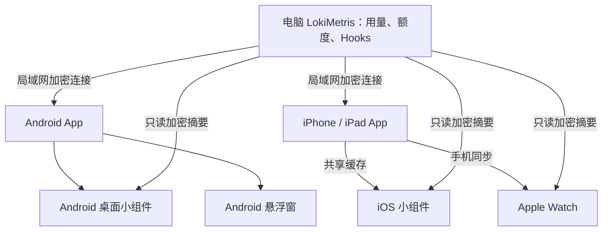

# 诡秘神谕移动展示终端 · LokiMetrisDisplay

**桌面客户端：[LokiMetris · 诡秘神谕](https://github.com/ManonLoki/LokiMetis)** —— 电脑负责采集用量与活动，移动端负责展示。

在 Android、iPhone、iPad、Apple Watch 和小组件上，查看电脑上的 AI 编程工具用量、账户额度与运行状态。两端通过局域网连接，首次使用四位码配对，之后自动重连。

中文系统里的应用名为“诡秘神谕”，其他语言显示为“LokiMetris”。

[下载 Android APK](https://github.com/ManonLoki/LokiMetisMobileDisplay/releases/latest) · [查看版本更新](https://github.com/ManonLoki/LokiMetisMobileDisplay/releases) · [从源码运行](#从源码运行)

## 功能

- **当日 Token 用量**：Token 是模型处理内容的计量单位。显示桌面统计日期对应的总量与各工具明细，支持大字精简模式与分项详细模式，保留完整整数。
- **账户额度**：展示桌面提供的 Codex、Claude Code、Cursor、Grok 额度，包括来源实际提供的五小时、周或账单月周期，以及剩余比例与套餐标签。
- **Agent 活动**：通过 Hooks（工具发送的活动事件）查看空闲、运行、等待确认、出错四种状态，以及对应正文、图片与动图。手机和平板支持每页一张或四张卡片，点击可看详情。
- **自定义展示台**：用量和 Hooks 可独立开关，适配手机、平板、横竖屏与大字号，保存本机布局偏好。
- **自动发现与重连**：前台寻找局域网内的电脑，首次由用户选择并配对；之后自动连接已保存的电脑。设置中可修改设备名称、重试连接或忘记配对。
- **跟随桌面 Agent 开关**：用量明细和额度只展示桌面已开启的 Agent，总量保留桌面提供的原值。

移动端展示电脑提供的当日快照，不独立采集 AI 会话、不重新计算总量，也没有历史日期查询。额度由桌面读取，移动端不需要保存各 AI 工具的登录凭据；Cursor 额度卡片也不代表已取得其完整账户 Token 明细。

## 各端怎么用

| 入口 | 功能 |
| --- | --- |
| Android App | 手机、平板完整展示台；可手动开启后台实时同步 |
| Android 桌面小组件 | 可调整尺寸，查看最近同步的用量、额度、活动摘要与同步时间，支持手动刷新 |
| Android 悬浮窗 | 在其他应用上方查看紧凑卡片；Token 页显示总量与最多四个额度账户，Hooks 页显示最多四条状态与正文首行，不显示图片 |
| iPhone / iPad App | 原生 SwiftUI 展示台，保留最近缓存；iPad 支持多窗口共用连接 |
| iOS 小组件 | 桌面小号、中号，以及锁屏单行、圆形、矩形摘要 |
| Apple Watch | 左右切换 Hooks、Token、额度，支持动图、离线缓存与常亮显示（Always On） |

Android 悬浮窗需开启系统的“显示在其他应用上层”权限。拖动标题可移动，点击或左右滑动可换页；锁屏隐藏、解锁恢复，关闭悬浮窗后后台同步继续运行。

## 支持的设备

| 设备 | 最低系统 | 说明 |
| --- | --- | --- |
| Android 手机、平板 | Android 12（API 31） | 原生库支持 `arm64-v8a`、`x86_64`，适用于相应真机与模拟器 |
| iPhone | iOS 18.2 | 原生 SwiftUI 应用 |
| iPad | iPadOS 18.2 | 平板布局与多窗口 |
| Apple Watch | watchOS 11.0 | 首次配置需要已配对的 iPhone；Always On 取决于表款及系统设置 |

## 安装与连接

### 安装应用

**Android**：从 [GitHub Releases](https://github.com/ManonLoki/LokiMetisMobileDisplay/releases/latest) 下载 APK 安装，附件中的 `SHA256SUMS` 可用于校验。

**iPhone / iPad / Apple Watch**：当前通过 Xcode 开发签名安装，见下方[源码运行说明](#iphone--ipad)。iPhone 宿主同时包含 Widget 和 Watch 应用；Watch 需要与 iPhone 配对。

使用同签名安装包覆盖升级，可保留本机数据。Android 卸载会删除本机配对材料，重新安装后需要再次配对；签名说明见 [signing/README.md](signing/README.md)。

### 第一次连接电脑

1. 在电脑上启动 [LokiMetris 桌面端](https://github.com/ManonLoki/LokiMetis)，让电脑和移动设备处于同一局域网。
2. 打开移动 App，进入“设置”，选择发现的电脑；允许系统提示的本地网络访问。
3. 移动端显示四位码后，保持 App 在前台，在电脑自动弹出的配对窗口中输入该码。四位码有效期为 60 秒，过期后重新发起即可。
4. 显示“已连接”后，回到“展示台”查看数据。以后打开 App 会自动连接保存的配对。

在移动端忘记配对只移除本机凭据；电脑上的旧设备记录需在桌面端单独移除。

### 添加小组件与 Watch

- **Android 小组件**：在 App 设置中快捷添加，或长按系统桌面，从“诡秘神谕／LokiMetris”的小组件列表中添加。
- **iOS 小组件**：安装后先打开 App、完成配对和一次同步，再从桌面或锁屏添加小组件。
- **Apple Watch**：先在已配对的 iPhone 上完成电脑配对，再打开手表应用自动同步，无需在手表上再次输入配对码。新正文和图片通过 iPhone 同步。

如需延长抬腕后的停留时间，可在手表“设置 → 通用 → 返回表盘”中调整本应用的返回时间。常亮显示仍遵守表款、省电和减少动态效果等系统设置。

## 后台更新与离线

| 入口 | 断线或进入后台后的行为 |
| --- | --- |
| Android 主展示台 | 只显示当前连接数据；断线后清空，重启不恢复旧面板。未开启实时同步时，进入后台会关闭连接 |
| Android 后台实时同步 | 用户手动开启后，通过前台服务维持连接并显示持续通知；系统结束进程或设备重启后需重新开启 |
| Android 小组件 | 独立保留最近一次摘要和原同步时间，刷新失败时继续显示旧结果 |
| iPhone / iPad | 保留最近数据与同步时间；进入后台关闭持续连接，系统后台任务可短暂连接电脑更新摘要 |
| iOS 小组件 | 可独立向已配对电脑读取只读摘要，失败时保留缓存 |
| Apple Watch | 优先从 iPhone 同步；手机不可达时可向电脑读取摘要，新正文和图片仍需通过手机获取 |

Apple App、小组件与 Watch 的后台刷新申请间隔约为 **5 分钟**，Android 普通后台任务的申请间隔为 **15 分钟**。实际执行时间由系统调度与省电策略决定，不保证准时更新或持续实时连接。

小组件的独立摘要包含用量、额度与活动状态，不包含 Hooks 正文和图片。离线缓存以原同步时间标识；电脑需要在线且局域网可达，才能取得新数据。

## 从源码运行

以下命令以 macOS 为例。iPhone / iPad 当前只配置 ARM64 真机与模拟器目标，同时开发 Android 和 Apple 端可使用 **Apple Silicon Mac**。

### 工具与源码

| 工具 | 用途 |
| --- | --- |
| JDK 21 | Gradle 构建，仓库配置使用 Azul 21 |
| Android Studio、SDK、NDK | Android 开发；需要 SDK Platform 37、Platform Tools，以及包含 API 31 Clang 的 NDK |
| Xcode | iPhone、iPad、Watch 与 Widget 开发，需要对应系统的 SDK 和模拟器运行时 |
| Rust / Cargo / rustup | 编译共享配对与加密核心，版本要求见所选桌面仓库的 `Cargo.toml` |
| Python 3 | 运行仓库自带的构建与签名脚本，无第三方 Python 依赖 |

Gradle 使用项目的 `./gradlew`。完整移动 App 还依赖桌面仓库中的 Rust 源码，需同时准备两个仓库，并选择与移动版本兼容的桌面提交：

```sh
git clone https://github.com/ManonLoki/LokiMetisMobileDisplay.git
git clone https://github.com/ManonLoki/LokiMetis.git
cd LokiMetisMobileDisplay
```

下面的 `/absolute/path/to/LokiMetis` 请替换为桌面仓库的绝对路径。新环境应显式指定路径，不依赖脚本中的原开发环境默认值。

### Android

在 Android Studio 中打开本仓库。通过 SDK Manager 准备 SDK 与 NDK，在本机 `local.properties` 中设置 `sdk.dir`；也可使用 `ANDROID_HOME`，需要指定 NDK 时设置 `ANDROID_NDK_HOME`。

添加 Rust 编译目标：

```sh
rustup target add aarch64-linux-android x86_64-linux-android
```

Debug 与 Release 都使用项目固定签名。需要覆盖已有安装时，迁移原有 `signing/lokimetris.keystore` 和 `signing/signing.properties`；本机已有原开发证书时可运行 `python3 scripts/prepare_android_signing.py`。首次独立安装、无需兼容旧签名时初始化新签名：

```sh
python3 scripts/prepare_android_signing.py --new-key
```

将 SDK 的 `platform-tools` 加入 `PATH`。真机开启 USB 调试并允许电脑连接，或在 Android Studio 启动模拟器，然后构建安装：

```sh
./gradlew :androidApp:assembleDebug \
  -PlokiDesktopRoot=/absolute/path/to/LokiMetis

adb install -r androidApp/build/outputs/apk/debug/androidApp-debug.apk
adb shell am start -n com.manonloki.lokimetrisdisplay/.MainActivity
```

使用 IDE 调试时选择 `androidApp` 运行配置、目标设备并点击 **Debug**。桌面源码路径可写入本机 `~/.gradle/gradle.properties`：

```properties
lokiDesktopRoot=/absolute/path/to/LokiMetis
```

构建 Release APK 时，将任务换为 `:androidApp:assembleRelease`，保留路径参数；输出为 `androidApp/build/outputs/apk/release/androidApp-release.apk`。

### iPhone / iPad

添加 Rust 编译目标并打开 Xcode 工程：

```sh
rustup target add aarch64-apple-ios aarch64-apple-ios-sim
open iosApp/iosApp.xcodeproj
```

1. 选择 **iosApp** scheme，以及 iPhone 或 iPad 模拟器。
2. 在项目 Build Settings 添加 `LOKI_DESKTOP_ROOT`，值为桌面仓库的绝对路径。
3. 点击 **Run** 或 **Debug**，Xcode 会编译 Kotlin framework 与 Rust 桥；构建进程需能找到 JDK、`python3` 和 `cargo`。
4. 使用真机时，在 `iosApp/Configuration/Config.xcconfig` 中填写自己的 `TEAM_ID`，并准备对应签名与设备描述文件；在设备上开启开发者模式，在 Xcode 中完成设备连接。

`TEAM_ID` 参与生成 Bundle ID（应用标识）与 App Group（App 和小组件共用的存储容器）。主 App、Widget 和 Watch 的签名及配套标识需匹配；覆盖已有安装时沿用原团队与应用标识。

也可从命令行构建 iOS 模拟器应用：

```sh
xcodebuild -project iosApp/iosApp.xcodeproj \
  -scheme iosApp -configuration Debug \
  -destination 'generic/platform=iOS Simulator' \
  LOKI_DESKTOP_ROOT=/absolute/path/to/LokiMetis \
  CODE_SIGNING_ALLOWED=NO build
```

### Apple Watch

在 Xcode 选择 **LokiMetrisWatch** scheme 和目标手表，点击 **Run** 或 **Debug**。同步需要已配对的 iPhone / Watch 组合，并先在 iPhone 完成电脑配对；实体 Watch 同样需开启开发者模式并连接 Xcode。

Watch 应用使用 Swift，可单独构建模拟器目标：

```sh
xcodebuild -project iosApp/iosApp.xcodeproj \
  -scheme LokiMetrisWatch -configuration Debug \
  -sdk watchsimulator \
  -destination 'generic/platform=watchOS Simulator' \
  CODE_SIGNING_ALLOWED=NO build
```

## 技术与目录

Android 使用 Kotlin + Compose，Apple 各端使用原生 SwiftUI；配对与加密核心由桌面仓库的 Rust 模块提供。iPhone、iPad、Watch 与 Widget 共用部分 Swift 模型、缓存与传输逻辑。

```text
.
├── androidApp/       Android 入口、小组件、后台同步、悬浮窗与 JNI 包装
├── sharedUI/         Android Compose 展示台与设置
├── sharedLogic/      Kotlin 模型、协议校验及 Android 网络与存储
├── iosApp/
│   ├── iosApp/                iPhone / iPad 应用
│   ├── LokiMetrisWatch/       Apple Watch 应用
│   ├── LokiMetrisWidgets/     iOS 桌面与锁屏小组件
│   ├── WidgetShared/          App 与小组件共享容器
│   ├── Configuration/         Apple 版本与应用标识配置
│   └── iosApp.xcodeproj/      Xcode 工程
├── appleDisplay/     Apple 共用的 Swift 展示、缓存与传输逻辑
├── scripts/          Rust 桥构建、Android 签名与图标脚本
├── signing/          Android 签名说明
├── branding/         应用图标资源
├── docs/             功能与技术文档
└── gradle/           Wrapper、JDK 与依赖配置
```



版本名和构建号分别见 [Android 配置](androidApp/build.gradle.kts) 与 [Apple 配置](iosApp/Configuration/Config.xcconfig)。

## 常见问题

| 遇到的情况 | 检查方式 |
| --- | --- |
| 找不到电脑 | 确认桌面应用运行、处于同一局域网并允许本地网络访问；访客 Wi-Fi 隔离、VPN 和防火墙可能影响发现 |
| Android 切到后台后展示台没数据 | 未开启实时同步时，后台会关闭连接；返回前台等待重连，或在设置中手动开启后台实时同步 |
| 悬浮窗无法显示 | 检查“显示在其他应用上层”权限，锁屏时窗口会隐藏 |
| App 有数据，小组件为空 | 先完成一次前台配对同步；Apple 端检查 App Group 与签名，桌面端需支持只读摘要 |
| 小组件或 Watch 更新较慢 | 查看原同步时间；后台刷新受系统调度影响，Watch 的新正文和图片需由手机补齐 |
| 构建提示缺少 Rust bridge | 检查桌面源码是否完整，`lokiDesktopRoot` 或 `LOKI_DESKTOP_ROOT` 是否指向正确目录 |
| Android 无法覆盖安装 | 确认沿用原签名；迁移方式见[签名说明](signing/README.md) |

进一步阅读：[当前架构与 Archify 图](docs/07-当前架构.md)、[文件结构详解](docs/01-文件结构.md)、[技术架构](docs/02-技术架构.md)、[功能与交互](docs/03-业务需求整理.md)、[Android 签名](signing/README.md)。
