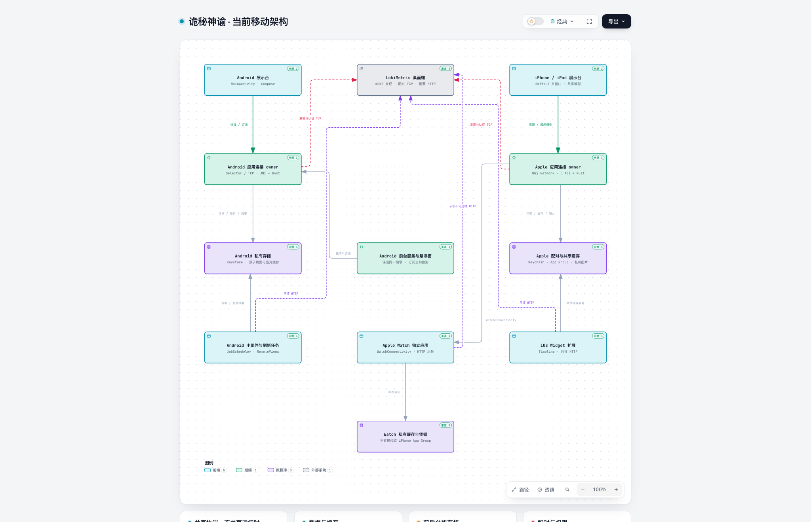

# 当前移动架构

[打开 Archify 交互图](../.archify/architecture-mobile-20261022-144530/mobile.html) · [查看图稿](../.archify/architecture-mobile-20261022-144530/candidate.json)

HTML 为独立页面，可下载后在浏览器打开。图展示主要运行关系，节点附有固定提交的源码位置；箭头标注操作方向与协议，不表示全部模块 import 依赖。

图稿源码基线：`62ed15366be138f0fc0daf85154cb27083130d30`；图稿梳理日期：2026-10-22。

**2026-10-22 共享层整理说明**：上述 Archify HTML、预览与图稿保留为本次重构前的快照，未重新生成；图内固定提交的链接继续指向当时源码。本次将仅支持 Android 的 `sharedUI` 合入 `androidApp`，并将面板、模型、展示、缓存、图片解码预算、只读 HTTP 边界、身份、连接期限／帧容量、Watch 通信事实与配置修订等规则提升到 `SharedLogic`。Watch 与小组件现也实际链接 Kotlin 框架，这些新增依赖和共享决策边界尚未反映在旧图中。主要网络数据流与平台 owner 未改变；下方文字和源码表已按当前工作树更新。

移动端展示电脑提供的当日快照，不重算总量。Android 与 Apple 的连接 owner、平台存储及缓存寿命不同；各端通过 `SharedLogic` 共用业务规则，平台仍分别执行网络、文件事务与后台任务。

## 主要链路

**Android 实时连接**：DisplayApplication 持有唯一 AndroidLanEngine；Selector owner 管理发现、TCP、分帧和计时，通过 JNI 调用编入 App 的 Rust 桥；连接阶段与期限、分帧容量和写队列预算使用 Kotlin 共同规则。Compose 页面和悬浮窗订阅同一展示投影。

**Android 后台与存储**：前台服务只延长同一引擎的后台连接资格，不创建第二个引擎。实时主面板只在内存；配对秘密由 Keystore 保护，图片与 Widget 摘要单独落盘。JobScheduler 可独立读取只读 HTTP 摘要。

**Apple 主应用**：SwiftUI 多窗口共用 LanLinkModel 与串行 LanLinkEngine。Network.framework 负责发现和 socket，C ABI 调用 Rust 协议；连接阶段、期限与帧／写队列预算、能力协商、设备形态、面板配置及分页使用共享规则。Keychain 保存配对，私有缓存保存图片，App Group 共享主应用缓存及组件摘要。

**iOS Widget**：Widget 扩展链接 iOS `SharedLogic`，通过 Timeline 读取 App Group，可使用独立只读权限向电脑请求加密摘要。模型校验、展示规则、租约与来源／时间／HTTP 接纳调用 Kotlin，Swift 在文件锁内提交结果。摘要不包含正文和图片。

**Apple Watch**：Watch 链接 watchOS `SharedLogic`，拥有自己的缓存和 Keychain。展示、校验、历史图像事实、前台租约、ACK／同步证明、图片传输选择与刷新判断由共享规则维护；Swift 保留原始字节组装、JSON、摘要、磁盘、系统传输和调度。配对及完整图文经 iPhone 的 WatchConnectivity；手机不可达时可独立请求电脑摘要，不直接读取 iPhone App Group，也不链接 Rust 桥。

**共享代码与后台**：Rust 配对、认证与主连接加密规则来自桌面源码，分别编入 Android 和 iPhone。`SharedLogic` 共用 Agent 别名／启用过滤／排序／行合并／Cursor 默认零行、Token 与额度、模型校验、面板、形态、缓存、身份、连接时序及 Watch 配置修订／撤销／去重规则；`TerminalWidgetSnapshot` 负责 Android 摘要裁剪。Swift 保留 Codable 字段、HTTP、系统加密与文件事务。`appleDisplay` 仍由各 Apple target 直接编译所需源码；SwiftPM 测试实际链接 macOS Kotlin 框架。Apple 普通后台关闭长连接，系统可以调度短时刷新。

**本轮共享的边界**：`TerminalSessionPhase` 与 `TerminalSessionTimingPolicy` 共用阶段、预算和到期原因；`TerminalFramePolicy`／`TerminalWritePolicy` 共用帧容量、长度和有界写队列。Android 的 ByteBuffer／ByteArray、Apple 的 Data 及系统回调继续留在原生适配器，容量判断不引入大块跨语言复制。首次快照期限起点仍有差异：iOS 沿用 connect 起点，Android 在认证确认写入完成回调中重开 15 秒预算。

`WatchCommunicationPolicy` 使用不可变状态管理前台租约和真实通信／完整同步事实，通过高低位无损搬运 UInt64（64 位无符号整数）纳秒时钟。`AssetTransferRules` 共用主 LAN 与 Watch 的图片完整描述／引用资格，以及主 LAN 待取候选位置；`WatchTransferRules` 决定 Watch 图片与快照的发送顺序。`WatchProtocolRules` 校验 RPC、元信息及快照／图片精确块边界，分别保留 96KiB／32MiB 上限。`WatchConfigurationPolicy` 用规范 u64 十进制字符串比较修订、处理撤销与重送去重，并判断缓存／在途作业是否仍相容；Swift Codable 的 UInt64 字段保持原样。

`ImageCachePolicy` 统一受保护文件、淘汰顺序与容量核算，实际删除成功后才扣除占用；iPhone 保留纯字节预算，Android／Watch 同时限制文件数。`ImageDecodePolicy` 统一图片像素、目标尺寸及 Apple 帧数／逐帧内存／缩边预算，系统解码器与像素缓冲仍在平台。`WidgetHttpPolicy` 统一只读摘要的固定路径、期限、响应接纳、容量、Base64 与认证元信息边界；平台保留 URL／JSON、流读取和加密执行，也保留既有请求容量与 Base64 接纳差异。`WidgetEndpointRules` 共用局域网地址字节分类与 scope 边界，系统 IPv6 解析和 Apple `.local` 支持保留。

**清理后的入口**：展示规则通过 `UsageDisplayPolicy` 和生产用量行投影调用，无消费者的转发和旧展示入口已删除，测试改测共享策略或生产投影。Apple 设备类别文件改名为 `LanDeviceFormFactor.swift` 并更新 Xcode 引用。Android 的 Compose 动效、系统动效监听、图片视图各有实际职责，保留 `ui/` 与 `ui/platform/`；应用 owner 继续向页面注入图片和权限动作。持久化字段、JNI 入口和平台 owner 不随这次清理改变。

畸形能力表在两端都不能保留独立 HTTP 授权，后台入口仍可提交其余合法摘要。本轮未扩张正文／图片的分发范围或系统权限。

**构建与测试**：`SharedLogic` 提供 iOS arm64 真机／arm64 模拟器、watchOS arm64_32／arm64 真机与 arm64 模拟器目标，以及 `macosArm64` 测试目标。Xcode 各 target 调用带进程锁的 `python3 scripts/build_apple_shared.py`；Apple 测试入口 `python3 scripts/test_apple_shared.py` 先构建 macOS 框架再执行 Swift 测试。

## 模块与源码

| 子系统 | 直接证据 |
| --- | --- |
| 模块与主连接 | [Android 依赖共享逻辑](../androidApp/build.gradle.kts#L15) · [发现与解析](../sharedLogic/src/androidMain/kotlin/com/manonloki/lokimetrisdisplay/connection/AndroidLanBrowser.kt#L20) · [连接选择与重试](../sharedLogic/src/commonMain/kotlin/com/manonloki/lokimetrisdisplay/protocol/TerminalTransport.kt#L24) · [共同阶段与期限](../sharedLogic/src/commonMain/kotlin/com/manonloki/lokimetrisdisplay/protocol/TerminalConnectionTiming.kt#L4) |
| 帧、写队列与能力 | [共同帧容量](../sharedLogic/src/commonMain/kotlin/com/manonloki/lokimetrisdisplay/protocol/TerminalFramePolicy.kt#L4) · [共同写队列预算](../sharedLogic/src/commonMain/kotlin/com/manonloki/lokimetrisdisplay/protocol/TerminalFramePolicy.kt#L19) · [共同能力表](../sharedLogic/src/commonMain/kotlin/com/manonloki/lokimetrisdisplay/protocol/TerminalCapabilities.kt#L4) · [Apple 原生缓冲](../appleDisplay/Sources/AppleDisplay/LanFrames.swift#L5) · [Android socket](../sharedLogic/src/androidMain/kotlin/com/manonloki/lokimetrisdisplay/connection/AndroidLanSocket.kt#L12) |
| 跨端展示规则 | [面板与分页](../sharedLogic/src/commonMain/kotlin/com/manonloki/lokimetrisdisplay/domain/PanelConfiguration.kt#L4) · [形态上报](../sharedLogic/src/commonMain/kotlin/com/manonloki/lokimetrisdisplay/protocol/TerminalDeviceType.kt#L21) · [Agent 与用量行](../sharedLogic/src/commonMain/kotlin/com/manonloki/lokimetrisdisplay/presentation/UsageDisplayPolicy.kt#L7) · [数字格式化](../sharedLogic/src/commonMain/kotlin/com/manonloki/lokimetrisdisplay/presentation/TokenFormatting.kt#L4) · [完整模型校验](../sharedLogic/src/commonMain/kotlin/com/manonloki/lokimetrisdisplay/domain/TerminalDisplay.kt#L4) |
| 缓存与身份规则 | [来源／时间与 HTTP 接纳](../sharedLogic/src/commonMain/kotlin/com/manonloki/lokimetrisdisplay/storage/SnapshotPolicy.kt#L7) · [租约与刷新](../sharedLogic/src/commonMain/kotlin/com/manonloki/lokimetrisdisplay/storage/SnapshotPolicy.kt#L29) · [读取凭据比较](../sharedLogic/src/commonMain/kotlin/com/manonloki/lokimetrisdisplay/storage/RefreshConnection.kt#L4) · [配对身份恢复](../sharedLogic/src/commonMain/kotlin/com/manonloki/lokimetrisdisplay/storage/DeviceIdentityRules.kt#L7) · [历史图片与清除事实](../sharedLogic/src/commonMain/kotlin/com/manonloki/lokimetrisdisplay/storage/HookImageCachePolicy.kt#L28) |
| 图片与只读 HTTP 规则 | [主 LAN／Watch 资源资格](../sharedLogic/src/commonMain/kotlin/com/manonloki/lokimetrisdisplay/protocol/AssetTransferPolicy.kt) · [图片淘汰与占用](../sharedLogic/src/commonMain/kotlin/com/manonloki/lokimetrisdisplay/storage/ImageCachePolicy.kt#L12) · [解码预算](../sharedLogic/src/commonMain/kotlin/com/manonloki/lokimetrisdisplay/presentation/ImageDecodePolicy.kt#L10) · [摘要 HTTP 边界](../sharedLogic/src/commonMain/kotlin/com/manonloki/lokimetrisdisplay/protocol/WidgetHttpPolicy.kt#L8) |
| Watch 通信与分块规则 | [不可变 UInt64 时钟表示](../sharedLogic/src/commonMain/kotlin/com/manonloki/lokimetrisdisplay/protocol/WatchTransferPolicy.kt#L4) · [前台租约与 ACK 事实](../sharedLogic/src/commonMain/kotlin/com/manonloki/lokimetrisdisplay/protocol/WatchTransferPolicy.kt#L16) · [图片与快照选择](../sharedLogic/src/commonMain/kotlin/com/manonloki/lokimetrisdisplay/protocol/WatchTransferPolicy.kt#L69) · [RPC 与快照／图片块边界](../sharedLogic/src/commonMain/kotlin/com/manonloki/lokimetrisdisplay/protocol/WatchTransferPolicy.kt#L85) · [Swift Data 组装](../appleDisplay/Sources/AppleDisplay/WatchProtocol.swift#L192) |
| Watch HTTP 配置规则 | [修订／撤销／去重](../sharedLogic/src/commonMain/kotlin/com/manonloki/lokimetrisdisplay/storage/WatchConfigurationPolicy.kt#L36) · [缓存与作业保留](../sharedLogic/src/commonMain/kotlin/com/manonloki/lokimetrisdisplay/storage/WatchConfigurationPolicy.kt#L91) · [Swift Codable 适配](../appleDisplay/Sources/AppleDisplay/WatchHTTPConfiguration.swift#L5) |
| 首次快照期限差异 | [Android 确认写完后重开](../sharedLogic/src/androidMain/kotlin/com/manonloki/lokimetrisdisplay/connection/AndroidLanEngine.kt#L295) · [iOS 沿用 connect 起点](../iosApp/iosApp/LanLinkEngine+Connection.swift#L183) |
| Android 应用与界面 | [入口与权限](../androidApp/src/main/kotlin/com/manonloki/lokimetrisdisplay/MainActivity.kt#L19) · [应用级唯一引擎](../androidApp/src/main/kotlin/com/manonloki/lokimetrisdisplay/application/DisplayApplication.kt#L13) · [网络 owner](../sharedLogic/src/androidMain/kotlin/com/manonloki/lokimetrisdisplay/connection/AndroidLanEngine.kt#L23) · [页面路由](../androidApp/src/main/kotlin/com/manonloki/lokimetrisdisplay/ui/App.kt#L29) · [系统动效资格](../androidApp/src/main/kotlin/com/manonloki/lokimetrisdisplay/ui/platform/AndroidCyberMotion.kt#L18) |
| Apple 应用与界面 | [应用入口](../iosApp/iosApp/iOSApp.swift#L4) · [Published 投影](../iosApp/iosApp/LanLinkModel.swift#L6) · [网络 owner](../iosApp/iosApp/LanLinkEngine.swift#L33) · [配置 SwiftUI 适配](../iosApp/iosApp/PanelPreferences.swift#L5) · [系统设备类别](../appleDisplay/Sources/AppleDisplay/LanDeviceFormFactor.swift#L2) |
| Rust 桥与私有存储 | [JNI 包装](../sharedLogic/src/androidMain/kotlin/com/manonloki/lokimetrisdisplay/nativebridge/NativeLinkBridge.kt#L6) · [JNI 映射 C ABI](../androidApp/src/main/c/loki_metris_jni.c#L6) · [Swift C ABI 包装](../iosApp/iosApp/NativeLinkBridge.swift#L4) · [Android 加密配对](../sharedLogic/src/androidMain/kotlin/com/manonloki/lokimetrisdisplay/storage/AndroidPairingStore.kt#L15) · [Apple Keychain 配对](../iosApp/iosApp/PairingStore.swift#L5) |
| Android 服务、悬浮窗与小组件 | [服务生命周期](../androidApp/src/main/kotlin/com/manonloki/lokimetrisdisplay/service/AndroidDisplayService.kt#L36) · [窗口与拖动](../androidApp/src/main/kotlin/com/manonloki/lokimetrisdisplay/overlay/AndroidOverlayWindow.kt#L26) · [系统刷新调度](../androidApp/src/main/kotlin/com/manonloki/lokimetrisdisplay/widget/AndroidRefreshScheduler.kt#L15) · [摘要渲染](../androidApp/src/main/kotlin/com/manonloki/lokimetrisdisplay/widget/MetrisWidgetProvider.kt#L26) · [摘要与独立授权](../sharedLogic/src/androidMain/kotlin/com/manonloki/lokimetrisdisplay/widget/AndroidWidgetStore.kt#L43) |
| Apple 缓存与 Widget | [缓存发布](../iosApp/iosApp/WidgetSnapshotPublisher.swift#L6) · [App Group 文件事务](../appleDisplay/Sources/AppleDisplay/WidgetSnapshotStore.swift#L46) · [Timeline](../iosApp/LokiMetrisWidgets/LokiMetrisWidgets.swift#L26) · [HTTP 更新](../iosApp/WidgetShared/WidgetContainer.swift#L4) · [摘要共享映射](../appleDisplay/Sources/AppleDisplay/WidgetSnapshot.swift#L97) |
| Apple Watch 独立应用 | [手机通道 owner](../iosApp/iosApp/PhoneWatchBridge.swift#L16) · [本表 owner](../iosApp/LokiMetrisWatch/WatchLinkEngine.swift#L15) · [本表 Keychain](../iosApp/LokiMetrisWatch/WatchHTTPConfigurationStore.swift#L5) · [展示缓存](../appleDisplay/Sources/AppleDisplay/WatchDisplayStore.swift#L46) · [刷新适配](../appleDisplay/Sources/AppleDisplay/WatchDisplayStore.swift#L85) |
| Apple 框架与实际测试入口 | [平台目标](../sharedLogic/build.gradle.kts#L10) · [Xcode 构建入口](../scripts/build_apple_shared.py#L33) · [macOS 测试入口](../scripts/test_apple_shared.py#L14) · [SwiftPM 框架链接](../appleDisplay/Package.swift#L15) |

## 图稿与检查记录（重构前快照）

以下回执、截图与哈希保留原始记录，未在本次结构整理中重跑图稿生成或浏览器检查。

- [最终生成回执](../.archify/architecture-mobile-20261022-144530/review-3/mobile.finalize.json)与[浏览器检查](../.archify/architecture-mobile-20261022-144530/review-3/mobile.browser-check.json)：Showcase 9/9，零错误、零警告。
- 已查看 1440×900、2048×1320 的浅色和深色截图；小窗口采用页面纵向滚动。
- [截图与感知复核记录](../.archify/architecture-mobile-20261022-144530/REPORT.md)。
- 图稿 SHA-256：`dd35cc64fac6408c5a2e78d79cd1104d0217f5272f1610774176abcfa8034352`。
- HTML SHA-256：`45bc30839d6d043ba25f53997c14169b180342331697c8edad406f42cc99bae9`。
