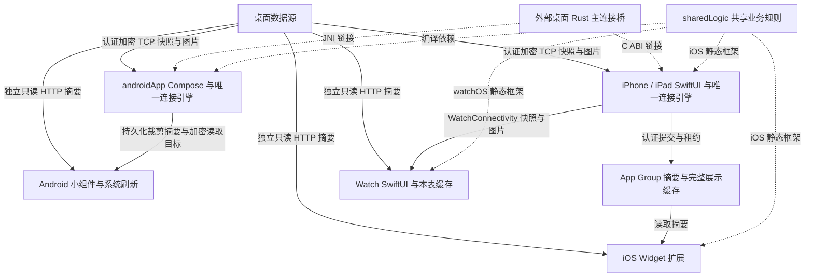

# 当前移动架构

核对日期：2026-10-22；对应 `v1.0.7` 的工作树。当前结构见下图与源码索引；旧 Archify 图保留在文末，作为固定提交的历史快照。实际测试与 UI 验证范围见 [v1.0.6 发布记录](09-v1.0.6发布与UI验证.md)。

## 当前模块与数据通路

实线为数据流，虚线为编译／链接依赖。Gradle 只包含 `androidApp`、`sharedLogic` 两个模块；Apple 主 App、Watch、Widget 三个 Xcode target 均链接各自平台的 SharedLogic。

`appleDisplay` 的 Swift 共享源码由各 Apple target 按需直接编译，负责 Codable、文件、系统网络／加密及 Watch 通道适配；它不是 Xcode 的额外 package product 依赖。`macosArm64` 框架仅用于 SwiftPM 测试，不是另一个 macOS 产品。

移动端展示电脑提供的当日快照，不重算总量。Android 与 Apple 的连接 owner、平台存储及缓存寿命不同；各端通过 `SharedLogic` 共用业务规则，平台仍分别执行网络、文件事务与后台任务。

## 主要链路

**Android 实时连接**：DisplayApplication 持有唯一 AndroidLanEngine；Selector owner 管理发现、TCP、分帧和计时，通过 JNI 调用编入 App 的 Rust 桥；连接阶段与期限、分帧容量和写队列预算使用 Kotlin 共同规则。Compose 页面和悬浮窗订阅同一展示投影。

**Android 后台与存储**：前台服务只延长同一引擎的后台连接资格，不创建第二个引擎。实时主面板只在当前连接内存；每份合法快照另裁剪并持久化 Widget 摘要。配对秘密由 Keystore 保护，图片单独落盘，小组件文件内的独立 HTTP 目标另行加密。JobScheduler 可独立读取只读 HTTP 摘要。

**Apple 主应用**：SwiftUI 多窗口共用 LanLinkModel 与串行 LanLinkEngine。Network.framework 负责发现和 socket，C ABI 调用 Rust 协议；连接阶段、期限与帧／写队列预算、能力协商、设备形态、面板配置及分页使用共享规则。Keychain 保存配对，私有缓存保存图片，App Group 共享主应用缓存及组件摘要。

**iOS Widget**：Widget 扩展链接 iOS `SharedLogic`，通过 Timeline 读取 App Group，可使用独立只读权限向电脑请求加密摘要。模型校验、展示规则、租约与来源／时间／HTTP 接纳调用 Kotlin，Swift 在文件锁内提交结果。摘要不包含正文和图片。

**Apple Watch**：Watch 链接 watchOS `SharedLogic`，拥有自己的缓存和 Keychain。展示、校验、历史图像事实、前台租约、ACK／同步证明、图片传输选择与刷新判断由共享规则维护；Swift 保留原始字节组装、JSON、摘要、磁盘、系统传输和调度。完整快照与图片经 iPhone 的 WatchConnectivity 传输；Watch 本身不配对桌面，Hooks 界面仅显示 Agent、状态与图片，没有正文或详情页；手机不可达时可独立请求电脑摘要，不直接读取 iPhone App Group，也不链接 Rust 桥。

**共享代码与后台**：Rust 配对、认证与主连接加密规则来自桌面源码，分别编入 Android 和 iPhone。`SharedLogic` 共用 Agent 别名／启用过滤／排序／行合并／Cursor 默认零行、Token 与额度、模型校验、面板、形态、缓存、身份、连接时序及 Watch 配置修订／撤销／去重规则；`TerminalWidgetSnapshot` 负责 Android 摘要裁剪。Swift 保留 Codable 字段、HTTP、系统加密与文件事务。`appleDisplay` 仍由各 Apple target 直接编译所需源码；SwiftPM 测试实际链接 macOS Kotlin 框架。Apple 普通后台关闭长连接，系统可以调度短时刷新。Apple 申请最早 5 分钟后的刷新，Android JobScheduler 申请 15 分钟周期，均不承诺准点执行。

**共同规则的边界**：`TerminalSessionPhase` 与 `TerminalSessionTimingPolicy` 共用阶段、预算和到期原因；`TerminalFramePolicy`／`TerminalWritePolicy` 共用帧容量、长度和有界写队列。Android 的 ByteBuffer／ByteArray、Apple 的 Data 及系统回调继续留在原生适配器，容量判断不引入大块跨语言复制。首次快照期限起点仍有差异：iOS 沿用 connect 起点，Android 在认证确认写入完成回调中重开 15 秒预算。

`WatchCommunicationPolicy` 使用不可变状态管理前台租约和真实通信／完整同步事实，通过高低位无损搬运 UInt64（64 位无符号整数）纳秒时钟。`AssetTransferRules` 共用主 LAN 与 Watch 的图片完整描述／引用资格，以及主 LAN 待取候选位置；`WatchTransferRules` 决定 Watch 图片与快照的发送顺序。`WatchProtocolRules` 校验 RPC、元信息及快照／图片精确块边界，分别保留 96KiB／32MiB 上限。`WatchConfigurationPolicy` 用规范 u64 十进制字符串比较修订、处理撤销与重送去重，并判断缓存／在途作业是否仍相容；Swift Codable 的 UInt64 字段保持原样。

`ImageCachePolicy` 统一受保护文件、淘汰顺序与容量核算，实际删除成功后才扣除占用；三端淘汰目标为 512 MiB，Android／Watch 另有 512 文件目标；当前引用始终保留，引用过多或删除失败时可以超出目标。iPhone 仅使用字节目标。`ImageDecodePolicy` 统一图片像素、目标尺寸及 Apple 帧数／逐帧内存／缩边预算，系统解码器与像素缓冲仍在平台。`WidgetHttpPolicy` 统一只读摘要的固定路径、期限、响应接纳、容量、Base64 与认证元信息边界；平台保留 URL／JSON、流读取和加密执行，也保留既有请求容量与 Base64 接纳差异。`WidgetEndpointRules` 共用局域网地址字节分类与 scope 边界，系统 IPv6 解析和 Apple `.local` 支持保留。

**清理后的入口**：展示规则通过 `UsageDisplayPolicy` 和生产用量行投影调用，无消费者的转发和旧展示入口已删除，测试改测共享策略或生产投影。Apple 设备类别文件改名为 `LanDeviceFormFactor.swift` 并更新 Xcode 引用。Android 的 Compose 动效、系统动效监听、图片视图各有实际职责，保留 `ui/` 与 `ui/platform/`；应用 owner 继续向页面注入图片和权限动作。Kotlin 目录按职责分组，但仍保留原 package 与 JNI 入口，目录本身不建立编译器强制的模块边界。

畸形能力表不授予新 HTTP 能力，但拒绝快照不等于清除已有授权：Android 实时入口严格校验失败后关闭会话，原 Widget 目标保留；Apple 前台先发起 Watch 配置撤销再拒绝快照，App Group 旧目标保留；Apple 后台可将本身合法的快照与空目标提交，并在提交阶段移除 App Group 旧目标。具体顺序见 [02 连接状态机](02-技术架构.md#连接状态机)。独立 HTTP 目标会保存认证连接得到的地址、端口和只读密钥；配对记录不保存固定 IP，不等于所有持久记录都不保存地址。

**构建与测试**：`SharedLogic` 提供 iOS arm64 真机／arm64 模拟器、watchOS arm64_32／arm64 真机与 arm64 模拟器目标，以及 `macosArm64` 测试目标。Xcode 各 target 调用带进程锁的 `python3 scripts/build_apple_shared.py`；Apple 测试入口 `python3 scripts/test_apple_shared.py` 先构建 macOS 框架再执行 Swift 测试。

## 模块与源码

以下链接指向文件，以表内类型或职责定位；不固定行号，避免注释与实现整理后跳到错误位置。

| 子系统 | 直接证据 |
| --- | --- |
| 模块与主连接 | [Android 依赖共享逻辑](../androidApp/build.gradle.kts) · [发现与解析](../sharedLogic/src/androidMain/kotlin/com/manonloki/lokimetrisdisplay/connection/AndroidLanBrowser.kt) · [连接选择与重试](../sharedLogic/src/commonMain/kotlin/com/manonloki/lokimetrisdisplay/protocol/TerminalTransport.kt) · [共同阶段与期限](../sharedLogic/src/commonMain/kotlin/com/manonloki/lokimetrisdisplay/protocol/TerminalConnectionTiming.kt) |
| 帧、写队列与能力 | [共同帧容量](../sharedLogic/src/commonMain/kotlin/com/manonloki/lokimetrisdisplay/protocol/TerminalFramePolicy.kt) · [共同写队列预算](../sharedLogic/src/commonMain/kotlin/com/manonloki/lokimetrisdisplay/protocol/TerminalFramePolicy.kt) · [共同能力表](../sharedLogic/src/commonMain/kotlin/com/manonloki/lokimetrisdisplay/protocol/TerminalCapabilities.kt) · [Apple 原生缓冲](../appleDisplay/Sources/AppleDisplay/LanFrames.swift) · [Android socket](../sharedLogic/src/androidMain/kotlin/com/manonloki/lokimetrisdisplay/connection/AndroidLanSocket.kt) |
| 跨端展示规则 | [面板与分页](../sharedLogic/src/commonMain/kotlin/com/manonloki/lokimetrisdisplay/domain/PanelConfiguration.kt) · [形态上报](../sharedLogic/src/commonMain/kotlin/com/manonloki/lokimetrisdisplay/protocol/TerminalDeviceType.kt) · [Agent 与用量行](../sharedLogic/src/commonMain/kotlin/com/manonloki/lokimetrisdisplay/presentation/UsageDisplayPolicy.kt) · [数字格式化](../sharedLogic/src/commonMain/kotlin/com/manonloki/lokimetrisdisplay/presentation/TokenFormatting.kt) · [完整模型校验](../sharedLogic/src/commonMain/kotlin/com/manonloki/lokimetrisdisplay/domain/TerminalDisplay.kt) |
| 缓存与身份规则 | [来源／时间与 HTTP 接纳](../sharedLogic/src/commonMain/kotlin/com/manonloki/lokimetrisdisplay/storage/SnapshotPolicy.kt) · [租约与刷新](../sharedLogic/src/commonMain/kotlin/com/manonloki/lokimetrisdisplay/storage/SnapshotPolicy.kt) · [读取凭据比较](../sharedLogic/src/commonMain/kotlin/com/manonloki/lokimetrisdisplay/storage/RefreshConnection.kt) · [配对身份恢复](../sharedLogic/src/commonMain/kotlin/com/manonloki/lokimetrisdisplay/storage/DeviceIdentityRules.kt) · [历史图片与清除事实](../sharedLogic/src/commonMain/kotlin/com/manonloki/lokimetrisdisplay/storage/HookImageCachePolicy.kt) |
| 图片与只读 HTTP 规则 | [主 LAN／Watch 资源资格](../sharedLogic/src/commonMain/kotlin/com/manonloki/lokimetrisdisplay/protocol/AssetTransferPolicy.kt) · [图片淘汰与占用](../sharedLogic/src/commonMain/kotlin/com/manonloki/lokimetrisdisplay/storage/ImageCachePolicy.kt) · [解码预算](../sharedLogic/src/commonMain/kotlin/com/manonloki/lokimetrisdisplay/presentation/ImageDecodePolicy.kt) · [摘要 HTTP 边界](../sharedLogic/src/commonMain/kotlin/com/manonloki/lokimetrisdisplay/protocol/WidgetHttpPolicy.kt) |
| Watch 通信与分块规则 | [不可变 UInt64 时钟表示](../sharedLogic/src/commonMain/kotlin/com/manonloki/lokimetrisdisplay/protocol/WatchTransferPolicy.kt) · [前台租约与 ACK 事实](../sharedLogic/src/commonMain/kotlin/com/manonloki/lokimetrisdisplay/protocol/WatchTransferPolicy.kt) · [图片与快照选择](../sharedLogic/src/commonMain/kotlin/com/manonloki/lokimetrisdisplay/protocol/WatchTransferPolicy.kt) · [RPC 与快照／图片块边界](../sharedLogic/src/commonMain/kotlin/com/manonloki/lokimetrisdisplay/protocol/WatchTransferPolicy.kt) · [Swift Data 组装](../appleDisplay/Sources/AppleDisplay/WatchProtocol.swift) |
| Watch HTTP 配置规则 | [修订／撤销／去重](../sharedLogic/src/commonMain/kotlin/com/manonloki/lokimetrisdisplay/storage/WatchConfigurationPolicy.kt) · [缓存与作业保留](../sharedLogic/src/commonMain/kotlin/com/manonloki/lokimetrisdisplay/storage/WatchConfigurationPolicy.kt) · [Swift Codable 适配](../appleDisplay/Sources/AppleDisplay/WatchHTTPConfiguration.swift) |
| 首次快照期限差异 | [Android 确认写完后重开](../sharedLogic/src/androidMain/kotlin/com/manonloki/lokimetrisdisplay/connection/AndroidLanEngine.kt) · [iOS 沿用 connect 起点](../iosApp/iosApp/LanLinkEngine+Connection.swift) |
| Android 应用与界面 | [入口与权限](../androidApp/src/main/kotlin/com/manonloki/lokimetrisdisplay/MainActivity.kt) · [应用级唯一引擎](../androidApp/src/main/kotlin/com/manonloki/lokimetrisdisplay/application/DisplayApplication.kt) · [网络 owner](../sharedLogic/src/androidMain/kotlin/com/manonloki/lokimetrisdisplay/connection/AndroidLanEngine.kt) · [页面路由](../androidApp/src/main/kotlin/com/manonloki/lokimetrisdisplay/ui/App.kt) · [系统动效资格](../androidApp/src/main/kotlin/com/manonloki/lokimetrisdisplay/ui/platform/AndroidCyberMotion.kt) |
| Apple 应用与界面 | [应用入口](../iosApp/iosApp/iOSApp.swift) · [Published 投影](../iosApp/iosApp/LanLinkModel.swift) · [网络 owner](../iosApp/iosApp/LanLinkEngine.swift) · [配置 SwiftUI 适配](../iosApp/iosApp/PanelPreferences.swift) · [系统设备类别](../appleDisplay/Sources/AppleDisplay/LanDeviceFormFactor.swift) |
| Rust 桥与私有存储 | [JNI 包装](../sharedLogic/src/androidMain/kotlin/com/manonloki/lokimetrisdisplay/nativebridge/NativeLinkBridge.kt) · [JNI 映射 C ABI](../androidApp/src/main/c/loki_metris_jni.c) · [Swift C ABI 包装](../iosApp/iosApp/NativeLinkBridge.swift) · [Android 加密配对](../sharedLogic/src/androidMain/kotlin/com/manonloki/lokimetrisdisplay/storage/AndroidPairingStore.kt) · [Apple Keychain 配对](../iosApp/iosApp/PairingStore.swift) |
| Android 服务、悬浮窗与小组件 | [服务生命周期](../androidApp/src/main/kotlin/com/manonloki/lokimetrisdisplay/service/AndroidDisplayService.kt) · [窗口与拖动](../androidApp/src/main/kotlin/com/manonloki/lokimetrisdisplay/overlay/AndroidOverlayWindow.kt) · [系统刷新调度](../androidApp/src/main/kotlin/com/manonloki/lokimetrisdisplay/widget/AndroidRefreshScheduler.kt) · [摘要渲染](../androidApp/src/main/kotlin/com/manonloki/lokimetrisdisplay/widget/MetrisWidgetProvider.kt) · [摘要与独立授权](../sharedLogic/src/androidMain/kotlin/com/manonloki/lokimetrisdisplay/widget/AndroidWidgetStore.kt) |
| Apple 缓存与 Widget | [缓存发布](../iosApp/iosApp/WidgetSnapshotPublisher.swift) · [App Group 文件事务](../appleDisplay/Sources/AppleDisplay/WidgetSnapshotStore.swift) · [Timeline](../iosApp/LokiMetrisWidgets/LokiMetrisWidgets.swift) · [HTTP 更新](../iosApp/WidgetShared/WidgetContainer.swift) · [摘要共享映射](../appleDisplay/Sources/AppleDisplay/WidgetSnapshot.swift) |
| Apple Watch 独立应用 | [手机通道 owner](../iosApp/iosApp/PhoneWatchBridge.swift) · [本表 owner](../iosApp/LokiMetrisWatch/WatchLinkEngine.swift) · [本表 Keychain](../iosApp/LokiMetrisWatch/WatchHTTPConfigurationStore.swift) · [展示缓存](../appleDisplay/Sources/AppleDisplay/WatchDisplayStore.swift) · [刷新适配](../appleDisplay/Sources/AppleDisplay/WatchDisplayStore.swift) |
| Apple 框架与实际测试入口 | [平台目标](../sharedLogic/build.gradle.kts) · [Xcode 构建入口](../scripts/build_apple_shared.py) · [macOS 测试入口](../scripts/test_apple_shared.py) · [SwiftPM 框架链接](../appleDisplay/Package.swift) |

## 界面、存储与平台限制

- Android 和 iPhone／iPad 主面板使用同一业务投影；窄窗口底部导航、宽窗口侧栏，展示台按可用区域宽高等分。iPad 切主入口重置子导航，App 级连接不重建。
- Android 主面板断线清空；小组件持久化无正文／图片摘要。Apple 主 App 在 App Group 保留完整展示缓存，图片字节在私有目录；Widget 显示摘要，Watch 使用本表缓存与图片目录。
- Watch 大快照与图片通过即时 RPC 分块、逐块 ACK；只读配置、撤销标记和容量允许的快照另通过 `updateApplicationContext` 送达。后台或不可达时可保留缓存、按资格尝试 HTTP，图片不会由摘要端点补取。
- 主连接的配对、认证和会话加密由桌面 Rust 桥执行；HTTP 摘要的认证加密使用 Apple CryptoKit／Android JCA。SharedLogic 共享边界判断，不拥有系统网络、密钥库或文件句柄。
- Android 最低 API 31（Android 12），原生库仅 `arm64-v8a`／`x86_64`；iOS／iPadOS 与 Widget 最低 18.2，Watch 最低 watchOS 11.0。Apple 模拟器与本机测试只声明 arm64，构建详情见 [01 文件结构](01-文件结构.md#构建链路)。

## 图稿与检查记录（重构前快照）

[打开重构前 Archify 交互图](../.archify/architecture-mobile-20261022-144530/mobile.html) · [查看历史图稿](../.archify/architecture-mobile-20261022-144530/candidate.json)

图稿基线为 `62ed15366be138f0fc0daf85154cb27083130d30`，生成日期为 2026-10-22，早于共享层重构及 `v1.0.6`。图内固定提交源码位置继续指向当时实现，不代表当前依赖：旧图没有反映 `sharedUI` 合入 `androidApp`，也没有反映 Watch 与 Widget 实际链接 SharedLogic。HTML 为可独立打开的历史页面。

以下回执、截图与哈希保留原始记录，本次未重新生成或验证历史 HTML。

- [最终生成回执](../.archify/architecture-mobile-20261022-144530/review-3/mobile.finalize.json)与[浏览器检查](../.archify/architecture-mobile-20261022-144530/review-3/mobile.browser-check.json)：Showcase 9/9，零错误、零警告。
- 已查看 1440×900、2048×1320 的浅色和深色截图；小窗口采用页面纵向滚动。
- [截图与感知复核记录](../.archify/architecture-mobile-20261022-144530/REPORT.md)。
- 图稿 SHA-256：`dd35cc64fac6408c5a2e78d79cd1104d0217f5272f1610774176abcfa8034352`。
- HTML SHA-256：`45bc30839d6d043ba25f53997c14169b180342331697c8edad406f42cc99bae9`。
