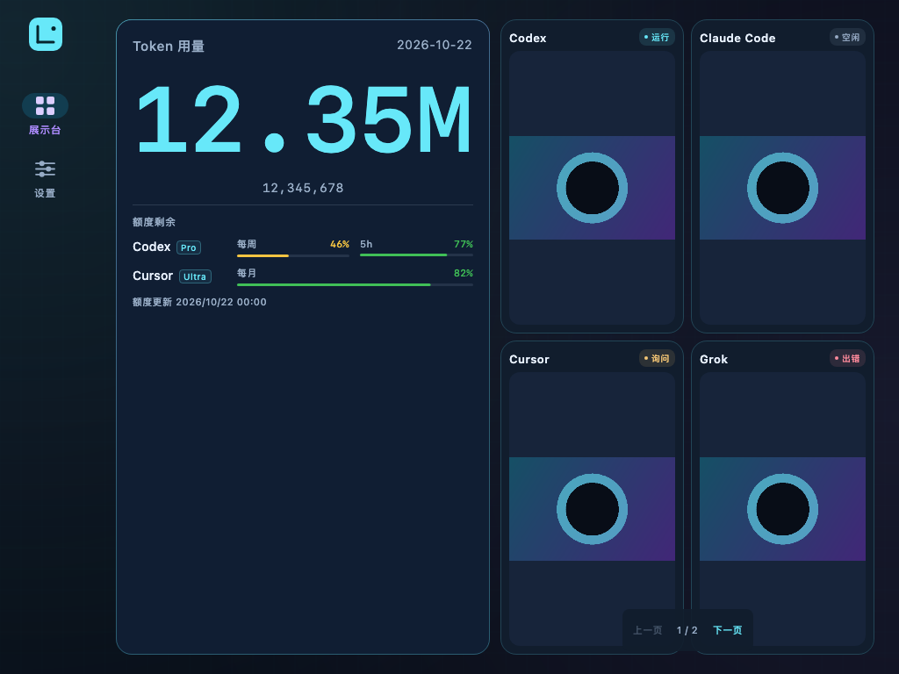

# 11 Desktop 实验展示终端

核对日期：2026-10-22。本文对应 `codex/desktop-experimental` 工作树，记录 DesktopApp 的使用、构建、兼容与验证范围。正式发布仍为 **v1.0.7**；本次没有创建发布标签或向正式 Releases 发布桌面安装包。

## 用途与界面

`desktopApp` 是运行在电脑窗口中的**展示终端**。数据仍由 [LokiMetris 采集端](https://github.com/ManonLoki/LokiMetis) 统计并通过局域网发送；DesktopApp 不扫描本机 AI 会话，不读取各工具登录凭据，也不重新计算 Token 总量。

它与 Android 平板共用 `sharedUI`：

- 宽窗口使用侧栏导航，用量与 Hooks 左右分区；缩窄后使用底部导航和上下分区。
- Token 支持精简与详细，保留完整整数、账户套餐和实际额度周期；Agent 筛选与排序调用 `sharedLogic`。
- Hooks 支持 1×1／2×2，鼠标可点“上一页／下一页”；点击卡片查看正文和大图。
- 图片支持 BMP、PNG、JPEG、WebP 与 GIF；动画遵循图片帧时长和循环数，在最小化或不可见时停止界面计时。
- 设备名称、面板开关和布局保存在本机。没有 Android 系统悬浮窗、小组件、后台服务设置或 Apple Watch 通道。



[设置示例](images/desktop-experimental/desktop-settings.png) · [窄窗口示例](images/desktop-experimental/desktop-narrow-panel.png)

上述 PNG 来自 Desktop Compose 自动化测试。数字、账户、正文和图片均为测试专用样例，使用隔离临时目录，不写入用户正式数据。静态截图只证明相应布局，不作为真实局域网配对或动画播放的证据。

## 连接与日常使用

1. 启动 LokiMetris 采集端，让两台电脑处于可通信的同一局域网；也可以在同一台电脑同时运行采集端和展示端。
2. 启动 DesktopApp，进入“设置”，从自动发现列表选择采集端。
3. 在采集端配对窗口中输入展示端显示的四位码；配对窗口有效期为 60 秒。
4. 认证后收到第一份合法完整快照才显示“已连接”。之后启动会自动重连已保存且本轮发现的采集端。

窗口失焦和最小化不会关闭网络连接；最小化暂停动效，关闭窗口退出应用并释放连接。完整展示快照只在内存，断线后撤下用量、额度、Hooks 及对应图片投影，重启不显示旧面板。已校验图片可以留在磁盘，只有新认证快照再次引用后才恢复显示。

### Android 平板兼容身份

当前采集端协议只接受 `android`／`ios` 平台，设备形态只接受 `phone`／`tablet`。按用户指定的兼容方式，DesktopApp：

- 在加密设备信息中发送 `platform: "android"`、`appVersion: "1.0.7-desktop-experimental"`，本机持久 UUID 和名称仍按实际配置发送。
- 仅在当前认证快照广告 `deviceFormFactorV1` 能力后，上报一次 `formFactor: "tablet"`；重连后重新协商。
- 不修改外部采集端源码、不扩展其平台枚举。因此采集端会将此终端识别为 Android 平板。

这只影响对端协议中的设备类别，DesktopApp 实际仍是运行在 JVM（Java 虚拟机）上的桌面应用。发现目前通过 IPv4 多播发送 mDNS 查询，可解析收到的 AAAA（IPv6 地址）记录；尚未建立 IPv6 多播发现通道，不能视为已支持 IPv6-only 局域网。

## 从源码运行与打包

桌面功能开发、修复和集成验证统一使用 `codex/desktop-experimental`，跟踪 `origin/codex/desktop-experimental`。沿用当前仓库和 `origin`，不创建 fork；此分支与 `main` 禁止互相 merge、squash、rebase 或 cherry-pick，也不创建以 `main` 为目标的桌面实验合并请求。仓库协作规则见 [AGENTS.md](../AGENTS.md)。

需要完整 JDK 21、Rust/Cargo、Python 3 和当前系统的 C 编译工具；本次构建辅助脚本已在 Python 3.9 下验证，不要求额外安装第三方模块。Gradle 使用仓库 wrapper，Python 脚本只使用标准库，不安装开发工具。额外需要采集端完整工作区中的 `loki_metris_pairing`、`loki_metris_mobile_bridge` 及一份匹配源码的根目录 `Cargo.lock`。采集端远程仓库当前忽略锁文件，单独 `git clone` 不会带上它；可沿用已验证的本地锁，或按下节使用本仓库冻结锁。

```sh
git switch codex/desktop-experimental
./gradlew :desktopApp:run \
  -PlokiDesktopRoot=/absolute/path/to/LokiMetis
```

| 系统 | 原生构建工具 | 当前范围 |
| --- | --- | --- |
| macOS | Xcode Command Line Tools，含 Clang、macOS SDK、`install_name_tool` 和 `codesign` | 本次已验证 Apple Silicon arm64 |
| Linux | C 编译器与 libc 开发文件 | Ubuntu 22.04 amd64 上自动测试及 DEB 构建通过，交互式安装与真实局域网配对未验证 |
| Windows | 与 Rust 宿主相符的 Visual Studio MSVC Native Tools，或 MinGW GCC；MSI 还需 JDK 21 所使用的 WiX 3（`candle.exe`、`light.exe`） | Windows 2025 x64 MSVC 上自动测试及 MSI 构建通过；交互式安装与真实局域网配对未验证。使用 `gradlew.bat` |

构建只生成当前系统、当前架构的原生库，没有在 macOS 上交叉生成 Windows／Linux 产物。未据此声明统一最低系统版本。

Gradle 默认使用 `python3` 执行两个桌面构建脚本。Windows 的 `python3.exe` 可能是打开 Microsoft Store 的占位程序；遇到此情况，使用 `-PlokiPython` 指定真实 Python 可执行文件的完整路径，路径参数整体加引号：

```powershell
.\gradlew.bat :desktopApp:run `
  "-PlokiDesktopRoot=C:\src\LokiMetis" `
  "-PlokiPython=C:\path\to\python.exe"
```

将示例路径替换为本机实际位置。该选项同时用于宿主原生库与隔离 Rust 测试端构建，不改变系统默认 Python，也不安装或升级工具。原生构建任务以宿主操作系统、架构及 JDK 路径作为缓存输入，避免共享工作目录时复用另一平台的 `.dll`、`.so` 或 `.dylib`。


### 准备 Rust 依赖锁

本仓库的 [desktopApp/native/Cargo.lock](../desktopApp/native/Cargo.lock) 冻结本机已经验证的完整 Rust 依赖解析，用于采集端源码提交 `0e326ceb745d7fa50119d61ab5a2ee59d868c9f6`；它保存在展示端实验分支中，不依赖采集端远程仓库跟踪该文件。本次冻结不升级依赖。

冻结锁的 SHA-256：

```text
ee38afedb4cf06bc1b6058d8b08fb925613c8a235afe59879fb25385a79c53d1
```

新克隆采集端源码后，先查看实际提交：

```sh
git -C /absolute/path/to/LokiMetis rev-parse HEAD
```

确认结果为上面的完整源码提交后，仅在采集端根目录没有 `Cargo.lock` 时，将本仓库 `desktopApp/native/Cargo.lock` 复制为 `/absolute/path/to/LokiMetis/Cargo.lock`。目标已经有锁时保留原文件并核对其依赖基线；不要自动覆盖或为了通过构建重新解析依赖。冻结锁对应本次固定源码，不作为任意采集端提交的通用锁。

CI 的 [desktop_ci.py](../scripts/desktop_ci.py) 先确认检出提交完全匹配，再向临时工作区补入缺失的冻结锁并打印其 SHA-256；若已有锁与冻结锁不同则明确失败，不覆盖。此步骤只作用于 CI 临时检出目录，没有修改用户本机的外部采集端仓库。

### 原生库构建

`desktopApp:buildDesktopNative` 调用 [build_desktop_native.py](../scripts/build_desktop_native.py)，以 `cargo build --locked --lib --target <宿主>` 编译外部 Rust 桥，再用本仓库已有的 [JNI C 包装](../androidApp/src/main/c/loki_metris_jni.c) 生成宿主 JNI 库。JNI 是 JVM 调用本机原生代码的接口。脚本显式传入当前宿主架构，产物隔离在本项目的 `build/`，不修改外部源码或锁文件。

也可单独调用脚本：

```sh
python3 scripts/build_desktop_native.py \
  --desktop-root /absolute/path/to/LokiMetis \
  --java-home /absolute/path/to/jdk-21 \
  --out desktopApp/build/generated/desktopNative
```

当前 Gradle 任务沿用脚本默认的 Cargo Debug 配置；桌面安装包的名称不代表其中 Rust 桥已经采用 Release 优化。独立脚本可显式传 `--configuration release`，其输出需与对应构建任务安排一致。

两个原生库随当前架构 JAR 一起分发，启动时提取到本用户私有临时目录并按绝对路径加载，安装后的应用不依赖开发机上的源码目录。

### 应用目录与安装包

```sh
./gradlew :desktopApp:createDistributable \
  -PlokiDesktopRoot=/absolute/path/to/LokiMetis
./gradlew :desktopApp:packageDistributionForCurrentOS \
  -PlokiDesktopRoot=/absolute/path/to/LokiMetis
```

`createDistributable` 生成携带运行时的当前系统应用目录；macOS 路径为 `desktopApp/build/compose/binaries/main/app/LokiMetrisDisplay.app`。`packageDistributionForCurrentOS` 使用当前系统的分发格式，配置为 macOS DMG、Windows MSI、Linux DEB。生成应用目录、生成安装包、开发者签名／公证、对外发布是不同步骤，执行结果分别记录在下方。

在 Windows x64 宿主上先运行测试，再生成 MSI：

```powershell
.\gradlew.bat :sharedLogic:desktopTest :desktopApp:desktopTest :desktopApp:packageMsi `
  "-PlokiDesktopRoot=C:\src\LokiMetis" `
  "-PlokiPython=C:\path\to\python.exe"
```

在 Linux x64 宿主上生成 DEB：

```sh
./gradlew :sharedLogic:desktopTest :desktopApp:desktopTest :desktopApp:packageDeb \
  -PlokiDesktopRoot=/absolute/path/to/LokiMetis
```

无图形会话的 Linux 主机运行 Compose UI 测试时需要 Xvfb（虚拟显示服务）；CI 已用 `xvfb-run` 提供测试画面。安装包位于 `desktopApp/build/compose/binaries/main/` 下相应格式目录，Linux 包名配置为 `lokimetris-display`。本机产物只包含本机架构。

Desktop 打包配置暂沿用包版本 `1.0.7`，没有独立桌面构建号；Android 仍为 `1.0.7 (9)`，Apple 为 `1.0.7 (15)`。这些配置值不表示已发布新的桌面版本。

### GitHub Actions 构建与下载

[desktop-build.yml](../.github/workflows/desktop-build.yml) 在 `codex/desktop-experimental` 的相关源码或构建配置推送后自动运行；需要重跑已有运行时，在运行详情选择 **Re-run jobs**。实验分支专有工作流的手动新建运行入口尚未验证。任务条件限定为实验分支，不将改动合入 `main`，不创建 GitHub Release。

| 任务 | 宿主 | 测试与打包 | 成功后安装包 artifact |
| --- | --- | --- | --- |
| `windows-x64` | GitHub `windows-2025`，x64 | `:sharedLogic:desktopTest`、`:desktopApp:desktopTest`、`:desktopApp:packageMsi` | `desktop-windows-x64` |
| `linux-amd64` | GitHub `ubuntu-22.04`，x64 | `:sharedLogic:desktopTest`、`:desktopApp:desktopTest`、`:desktopApp:packageDeb` | `desktop-linux-amd64` |

两端使用 Zulu JDK 21 和 Rust **1.98.1**，检出完整外部 Rust 工作区并固定到 `0e326ceb745d7fa50119d61ab5a2ee59d868c9f6`。采集端 checkout 缺失的 `Cargo.lock` 由本仓库冻结锁补齐；已有不同锁则失败。工作流核对实际工具版本、路径、源码提交和锁文件 SHA-256 后再运行测试；只有测试和安装包生成都成功后才收集对应安装包与 SHA-256 校验值。

下载步骤：

1. 打开仓库的 [实验 Desktop 构建记录](https://github.com/ManonLoki/LokiMetisMobileDisplay/actions/workflows/desktop-build.yml)，选择 `codex/desktop-experimental` 对应的运行。
2. 确认需要的平台任务成功；具体运行链接、测试数量与产物校验值以本节下方的验证记录为准。配置存在或任务开始不代表构建已经通过。
3. 在运行详情的 **Artifacts** 区域下载 `desktop-windows-x64` 或 `desktop-linux-amd64` 并解压，得到 MSI／DEB 及同目录 `SHA256SUMS`。
4. 用 SHA-256 核对安装包。例如 macOS 执行 `shasum -a 256 -c SHA256SUMS`，Linux 执行 `sha256sum -c SHA256SUMS`；Windows 可用 `Get-FileHash -Algorithm SHA256 .\安装包.msi` 与文件中对应行比较。

另有 `desktop-tests-windows-x64` 与 `desktop-tests-linux-amd64`，包含测试报告、XML 结果和测试专用 UI 截图，供失败排查。工作流配置的 artifact 保留期为 **14 天**；过期后需重新运行对应实验构建。产物通过 Actions 提供，不进入正式 Releases。


## 本机数据与源码入口

| 系统 | 默认数据目录 |
| --- | --- |
| macOS | `~/Library/Application Support/LokiMetrisDisplay/` |
| Windows | `%LOCALAPPDATA%\LokiMetrisDisplay\`，缺省回退到用户的 `AppData\Local` |
| Linux | `$XDG_DATA_HOME/LokiMetrisDisplay/`，缺省为 `~/.local/share/LokiMetrisDisplay/` |

| 文件 | 内容与寿命 |
| --- | --- |
| `settings.properties` | 本机 UUID、名称和面板偏好；完整原子提交。坏名称或布局回退默认，已有损坏 UUID 显式失败，不偷偷更换配对身份 |
| `pairings-v1.json` | 以采集端 UUID 索引的配对材料；提交成功后 Rust 才生成 ACK，忘记操作只删除精确记录 |
| `lan-assets-v1/` | 以 SHA-256 摘要寻址的已校验图片，当前认证快照引用优先保留；淘汰目标为 512 MiB／512 文件，不是强制硬上限 |

配对材料当前保存在本用户私有 JSON 文件，未接入系统钥匙串或平台密钥库。POSIX 系统限制目录为 0700、文件为 0600；Windows 配对与资源存储通过 ACL（访问控制列表）限制用户访问。主面板完整快照没有持久恢复文件，也没有小组件只读 HTTP 目标。

| 要修改的内容 | 入口 |
| --- | --- |
| 共用界面 | `sharedUI/src/commonMain/kotlin/com/manonloki/lokimetrisdisplay/` |
| 窗口、设置、图片、时间 | `desktopApp/src/desktopMain/kotlin/com/manonloki/lokimetrisdisplay/Desktop*.kt` |
| 发现、DNS 缓存、TCP 与连接状态 | 同目录 `connection/` |
| 严格 JSON 与平板兼容身份 | 同目录 `protocol/` |
| 配对、原子文件与图片缓存 | 同目录 `storage/` |
| Rust JNI 与资源库加载 | 同目录 `nativebridge/` |
| 公共业务及 JVM Unicode 比较键 | `sharedLogic/src/commonMain/`、`sharedLogic/src/desktopMain/` |

## 本次验证记录

本次外部 Rust 依据为提交 **`0e326ceb745d7fa50119d61ab5a2ee59d868c9f6`**。外部仓库位于其 `main`，核对时工作区干净，未为 Desktop 修改外部协议或源码。本仓库的 JNI C 源仍沿用 Android 的现有实现。

已确认的验证：

| 检查 | 已确认结果 |
| --- | --- |
| Desktop 宿主编译与本机原生库构建 | macOS arm64 通过 |
| Desktop 全量测试 | `:desktopApp:desktopTest` 共 26 项通过，0 失败；包括 DNS／TCP／协议／存储、设置重启与失败保护、PNG／JPEG／BMP／WebP／GIF、GIF 像素／70 与 130 ms 时长／有限循环、513 帧拒绝、宽窄布局、鼠标分页和详情 |
| mDNS 缓存一致性 | 分包多地址保留、cache-flush 的一秒宽限、goodbye 延迟失效与重新广播恢复均通过；实现依据 [RFC 6762 第 10 节](https://www.rfc-editor.org/rfc/rfc6762#section-10) |
| Rust JNI 与 TCP 全链路 | `DesktopConnectionIntegrationTest` 使用隔离 Rust 测试端，验证首次配对、存储后 ACK、新 TCP 恢复、Android 平板协商每连接仅一次、中文与 emoji 完整快照、PNG 校验下载、ping／pong、断线清空及关闭释放 |
| 原生构建 Python 辅助脚本 | 6 项通过，使用标准库；Python 3.9 可运行 |
| Android 回归与公共 JVM 规则 | `:androidApp:assembleDebug` 通过；`:sharedLogic:testAndroidHostTest` 149 项、`:sharedLogic:desktopTest` 133 项通过；不代表 Android 真机安装或配对验收 |
| macOS 应用目录与实际启动 | `:desktopApp:createDistributable` 成功；实际启动携带运行时的 `.app`，mDNS 发现成功 |
| 真实采集端配对与展示 | 用户在 Desktop 窗口手动完成配对，已看到实际 Token、额度与 Hooks 图片；真实内容截图不纳入文档 |
| UI 图片 | Desktop UI 测试生成五张 PNG，本文选用其中三张演示布局 |
| Windows x64 MSI CI | [本次任务成功](https://github.com/ManonLoki/LokiMetisMobileDisplay/actions/runs/39775395117/job/119812919428)，SharedLogic 133 项、DesktopApp 26 项通过，失败／错误／跳过均为 0，生成五张 UI 测试截图及 `LokiMetrisDisplay-1.0.7.msi` |
| Linux x64 DEB CI | [本次任务成功](https://github.com/ManonLoki/LokiMetisMobileDisplay/actions/runs/39775395117/job/119812919826)，SharedLogic 133 项、DesktopApp 26 项通过，失败／错误／跳过均为 0，生成五张 UI 测试截图及 `lokimetris-display_1.0.7_amd64.deb` |

自动化集成使用隔离测试端，与用户手动完成的真实采集端配对分别验证；测试数据没有进入正式采集端。macOS DMG、Windows／Linux 交互式安装及真实局域网配对、跨电脑真实局域网配对、IPv6-only 网络、Apple 构建／真机回归、开发者签名与公证均未验证；没有执行正式发布。

### Windows／Linux 安装包交付记录

本次 [CI 运行 39775395117](https://github.com/ManonLoki/LokiMetisMobileDisplay/actions/runs/39775395117) 整体为 `completed / success`。构建使用的展示端源码为 [`14c3c26090dbee9f259db769f772c7e117421809`](https://github.com/ManonLoki/LokiMetisMobileDisplay/commit/14c3c26090dbee9f259db769f772c7e117421809)，外部 Rust 提交和冻结锁 SHA-256 沿用上文固定值。两个平台均在自己的 CI 宿主完成测试与安装包生成，没有在 macOS 上交叉打包。

| 平台 | 安装包 | 字节数 | 下载 |
| --- | --- | ---: | --- |
| Windows x64 | `LokiMetrisDisplay-1.0.7.msi` | 66,276,038 | [desktop-windows-x64](https://github.com/ManonLoki/LokiMetisMobileDisplay/actions/runs/39775395117/artifacts/12423464488) |
| Linux amd64 | `lokimetris-display_1.0.7_amd64.deb` | 67,558,984 | [desktop-linux-amd64](https://github.com/ManonLoki/LokiMetisMobileDisplay/actions/runs/39775395117/artifacts/12424278490) |

两份 artifact 已下载，并分别按包内 `SHA256SUMS` 重新计算核对一致：

```text
8b2ebfdee31b6c1297d98d0f818750ca7041aad63f91a104230e8dfd54af90fb  LokiMetrisDisplay-1.0.7.msi
e3d81a0169a325f444c956a7b21f203cec127ab1f7b504c3f03e7e1c1655b6be  lokimetris-display_1.0.7_amd64.deb
```

MSI 的 `SummaryInformation` 模板核对为 `x64;1033`。DEB 控制元信息核对为版本 `1.0.7`、架构 `amd64`，启动器及 `libapplauncher` 为 ELF x86-64。两端 XML 结果各为 **133 项 SharedLogic + 26 项 DesktopApp，0 失败、0 错误、0 跳过**，各保留五张测试专用 UI 截图。

本记录证明原生宿主构建、自动化测试、安装包生成及下载完整性；Windows／Linux 尚未执行交互式安装、真实局域网配对或开发者签名验收。版本保持原配置，产物通过 Actions 交付，没有创建正式 Release 或新版本标签。

常用回归入口：

```sh
./gradlew :desktopApp:desktopTest :sharedLogic:desktopTest \
  -PlokiDesktopRoot=/absolute/path/to/LokiMetis
```

UI 测试截图生成在 `desktopApp/build/screenshots/`，文档使用最终测试输出的三张样例 PNG。文档中的本地目标路径与 `git diff --check` 已通过核对。文档核对已覆盖 README 的使用与启动、能力、设备／平台范围、目录、架构、版本与外部源码依赖；已有发布记录保持原范围，本次实验记录不替代未来正式发布时的 [发布检查清单](06-发布检查清单.md)。
